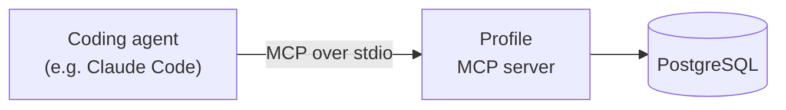

# Profile

[](https://github.com/SamEMason/profile/actions/workflows/ci.yml)

**A structured, persistent source of truth for a person's experiences.**

People constantly generate valuable experience through work, learning and projects, but most of it is never captured in a reusable form. Profile turns raw experience into structured data that many applications can use later.

> [!NOTE]
> **Status: early development.** The database and the MCP server are built. The coding-agent skill that drives capture is next. See the [roadmap](docs/roadmap.md).

**Contents:** [How it works](#how-it-works) · [What gets saved](#what-gets-saved) · [MCP tools](#mcp-tools) · [Getting started](#getting-started) · [Commands](#commands) · [Project layout](#project-layout) · [Contributing](#contributing)

## How it works

The first version captures software development experience through coding-agent skills, in two ways:

- **Ongoing:** after a piece of work, the agent proposes what you just did as an experience.
- **Retrospective:** the agent goes back through an existing repo and finds experiences in it.

Either way, the agent refines each record with you in conversation, and nothing is saved until you approve it.



The agent talks to Profile through an [MCP](https://modelcontextprotocol.io) server, which stores approved records in PostgreSQL. Scope is capture only for now: no résumés, portfolios or other ways to use the data yet.

## What gets saved

Each **experience** belongs to a profile and holds:

| Field         | What it is                              | Example                                              |
| ------------- | --------------------------------------- | ---------------------------------------------------- |
| `description` | What you did, in a sentence or two      | _Added an MCP server exposing CRUD tools over stdio_ |
| `skills`      | The skills it used (trimmed, non-empty) | `["TypeScript", "MCP", "PostgreSQL"]`                |
| `project`     | Where the work happened                 | `profile`                                            |
| `source`      | Where the record came from              | `ongoing capture`                                    |

Ids and `createdAt` / `updatedAt` timestamps are set automatically.

## MCP tools

| Tool                | What it does                                     |
| ------------------- | ------------------------------------------------ |
| `save_experience`   | Save a new, approved experience                  |
| `list_experiences`  | List the profile's experiences, newest first     |
| `get_experience`    | Get one experience by id                         |
| `update_experience` | Change some fields; fields left out stay as-is   |
| `delete_experience` | Delete an experience and return what was deleted |

Every tool acts on the current profile only. Bad input comes back to the agent as a readable error, one problem per line.

## Getting started

### Prerequisites

- [pnpm](https://pnpm.io). The project pins Node 24 and pnpm 12, and pnpm downloads both automatically.
- Docker with Compose, for example via [Colima](https://github.com/abiosoft/colima).

### Setup

1. **Configure the database.** Copy the example env file:

   ```sh
   cp .env.example .env
   ```

   Then replace `change-me` with a real password **in both places**: `POSTGRES_PASSWORD` and the password inside `DATABASE_URL`.

2. **Install dependencies:**

   ```sh
   pnpm install
   ```

3. **Start Postgres and create the tables.** `pnpm dev` starts Postgres and waits until it's healthy. Stop the app with <kbd>Ctrl</kbd>+<kbd>C</kbd> (Postgres keeps running), then apply the migrations:

   ```sh
   pnpm dev
   pnpm db:migrate
   ```

### Connect Claude Code

The repo includes a [`.mcp.json`](.mcp.json), so Claude Code starts the server itself (`pnpm --silent start:mcp`) when you open the project.

1. Make sure Colima is running.
2. Open the project in Claude Code and approve the `profile` server when asked.
3. After changing a tool, reconnect with `/mcp`.

> [!TIP]
> Browse what's been saved with `pnpm db:studio` (Drizzle Studio in the browser) or `pnpm db:psql` (a psql shell).

## Commands

<details open>
<summary><strong>Run</strong></summary>

| Command          | What it does                                                      |
| ---------------- | ----------------------------------------------------------------- |
| `pnpm dev`       | Start Postgres, then run the app with reload on save              |
| `pnpm start:mcp` | Start Postgres, then serve MCP over stdio (Claude Code runs this) |
| `pnpm build`     | Compile `src/` to `dist/`                                         |
| `pnpm start`     | Run the compiled output                                           |

</details>

<details open>
<summary><strong>Database</strong></summary>

| Command            | What it does                                                 |
| ------------------ | ------------------------------------------------------------ |
| `pnpm db:generate` | Generate a SQL migration from changes to `src/db/schema.ts`  |
| `pnpm db:migrate`  | Apply pending migrations                                     |
| `pnpm db:check`    | Fail if the schema has changes without a migration           |
| `pnpm db:studio`   | Browse and edit the data in Drizzle Studio                   |
| `pnpm db:psql`     | Open a psql session in the Postgres container (`\q` to quit) |
| `pnpm db:down`     | Stop Postgres, keeping its data                              |

</details>

<details open>
<summary><strong>Test and check</strong></summary>

| Command             | What it does                                                     |
| ------------------- | ---------------------------------------------------------------- |
| `pnpm test`         | Run the unit tests (no Docker needed)                            |
| `pnpm test:db`      | Run the database tests against a throwaway Postgres on port 5433 |
| `pnpm typecheck`    | Type-check everything                                            |
| `pnpm lint`         | ESLint                                                           |
| `pnpm format`       | Prettier, writing fixes                                          |
| `pnpm format:check` | Prettier, checking only                                          |

</details>

## Project layout

```text
src/
├── index.ts      entry point: serves MCP over stdio
├── mcp/          the MCP server and its tools
├── services/     the operations: save, list, get, update, delete
├── domain/       zod schemas derived from the tables
└── db/           connection and Drizzle table definitions
tests/            Vitest tests (tests/db/ needs Postgres)
migrations/       SQL migrations generated by drizzle-kit
scripts/          dev scripts (pnpm dev, start:mcp, db:check)
config/           tooling config (Vitest, Drizzle, lint-staged)
docs/             the roadmap and archived planning docs
```

The tables in `src/db/schema.ts` are the source of truth for the data shape: the domain schemas are derived from them, not written by hand.

**Built with** TypeScript, [MCP](https://modelcontextprotocol.io), PostgreSQL, [Drizzle ORM](https://orm.drizzle.team), [zod](https://zod.dev) and [Vitest](https://vitest.dev).

## Contributing

A pre-commit hook lints and formats staged files, then runs the typecheck, the migration check and the unit tests.

[CI](.github/workflows/ci.yml) runs all of those checks plus the database tests (`pnpm test:db`) on every push to `main` and every pull request.

The planned work is in the [roadmap](docs/roadmap.md). The original planning docs are in [docs/plan/archive](docs/plan/archive/).
