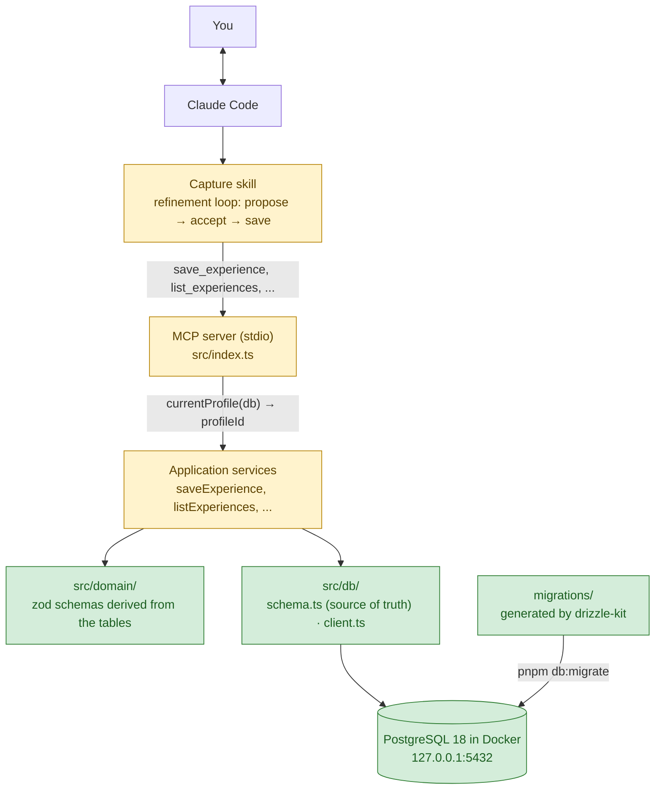
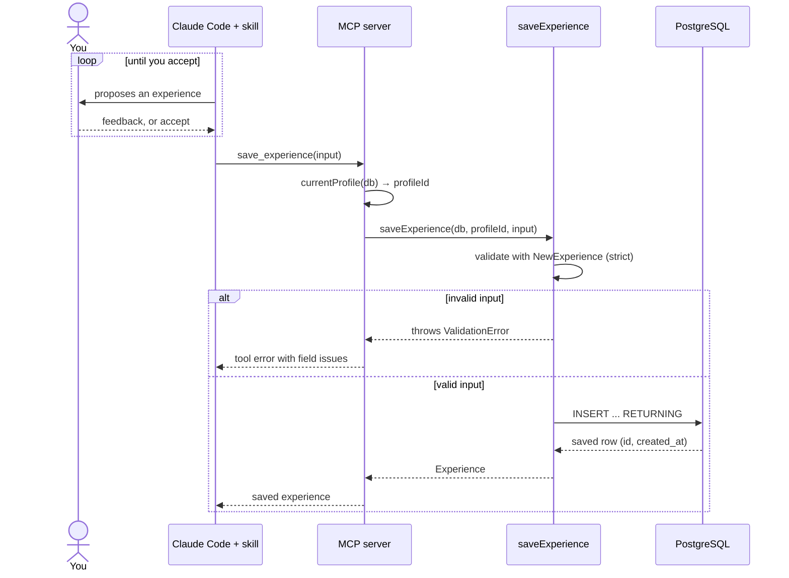
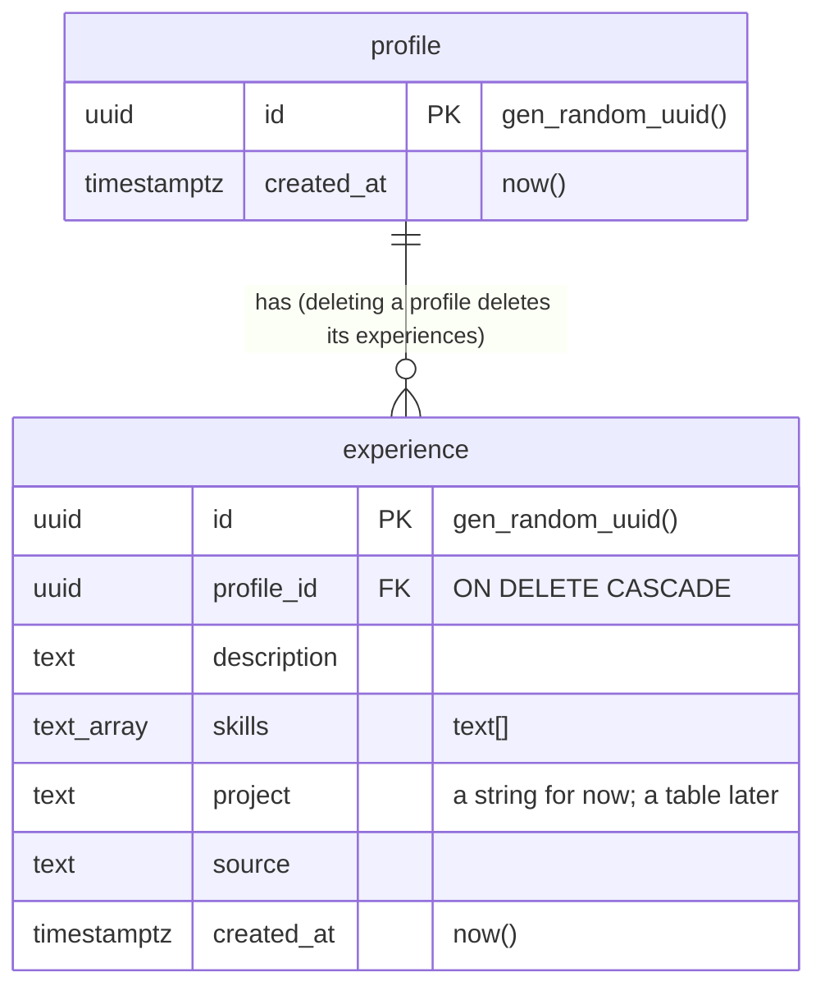
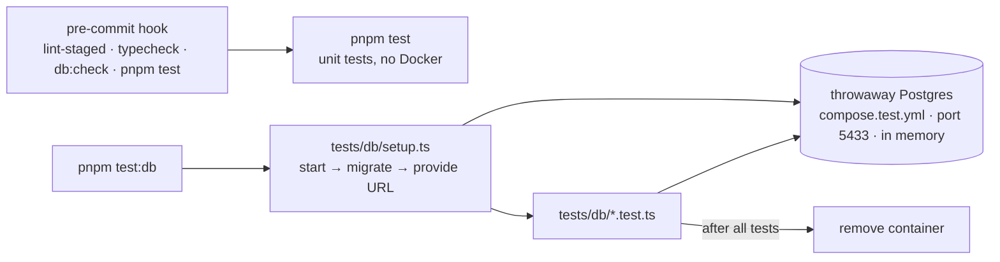

# Architecture

What exists today and how the pieces fit. For goals, phases and reasoning, see the [development plan](profile-development-plan.md).

## Layers

Each layer is a thin wrapper around the one below it. Green is built; amber is next.

- **Capture skill:** runs the refinement loop with you. Only records you accept are saved. The server can't verify approval; it's a rule in the skill.
- **MCP server:** stdio, started by Claude Code. Each tool resolves the profile with `currentProfile(db)` (like auth middleware), calls a service and turns thrown errors into tool errors the agent can act on. Logs go to stderr; stdout is the protocol.
- **Application services:** take `db` and `profileId` as parameters and never look them up. Validate input with `NewExperience` (strict) and throw `ValidationError` for bad input.
- **Data layer:** Drizzle tables in `src/db/schema.ts` are the source of truth. zod schemas in `src/domain/` are derived from them, and migrations are generated from them.
- **PostgreSQL:** runs in Docker (`compose.yml`), with data in the `profile_profile-data` volume.

## Saving an experience

`currentProfile` currently finds the single profile, creates it on first use and throws if there's more than one. With auth (Better Auth, later), it will read the signed-in user instead; the services won't change.

## Data model

Every column is `NOT NULL`. Tables use `snakeCase.table`: camelCase in TypeScript (`profileId`), snake_case in Postgres (`profile_id`).

## Tests

- `pnpm test` runs everything outside `tests/db/` and needs no Docker, so the pre-commit hook stays fast.
- `pnpm test:db` starts a fresh test database, migrates it, runs `tests/db/` one file at a time and removes it. Your real data is never touched. Run it before committing persistence changes.
- `pnpm db:check` (also in the hook) fails if `schema.ts` has changes without a migration.

## Key decisions

- PostgreSQL in Docker; Drizzle tables are the single source of truth for the data shape.
- Services take `profileId`; `currentProfile` is the one place that decides which profile, so adding auth changes one function.
- Only approved records are saved (refinement loop in the skill), so there's no status column.
- Validation is strict (no empty fields, no unknown keys), as a hypothesis to revisit after real use.
- Services throw; the MCP layer is the one place that turns errors into messages for the agent.
- Deferred: project as a table, `updatedAt` (with `updateExperience`), saved drafts, and auth.
